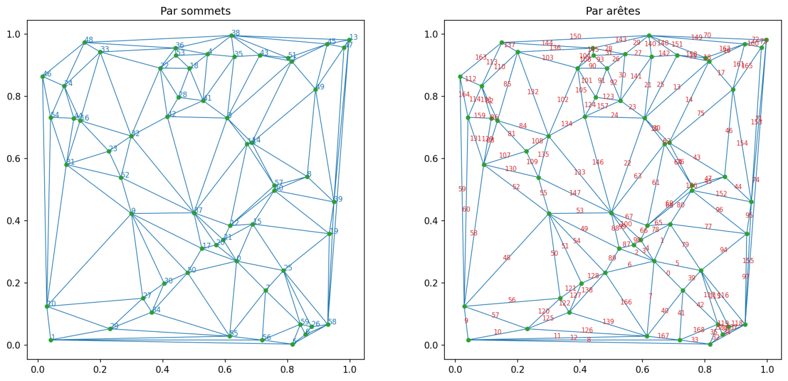
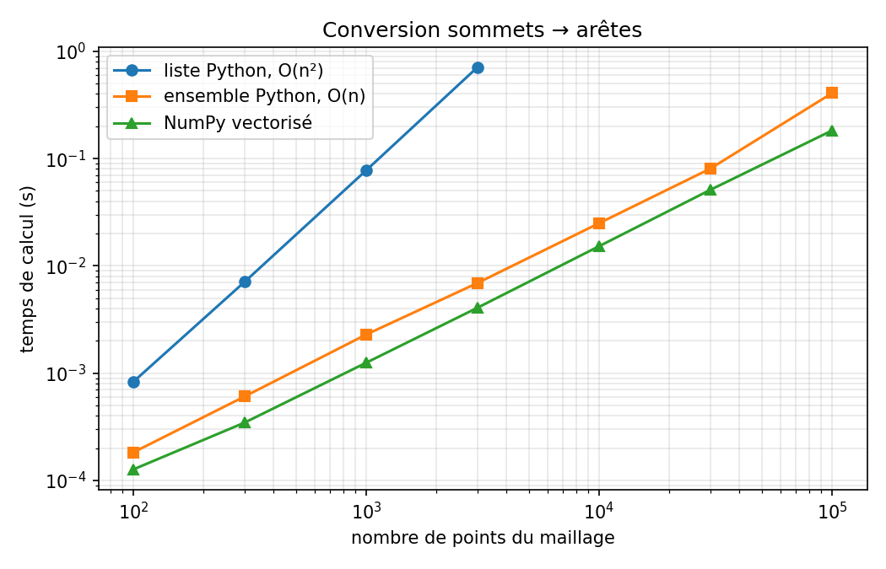

# Triangular mesh: from nodes to edges

Converting a triangular mesh from a node-based description to an edge-based one,
fast enough to be used on large meshes.



---

## The problem

A triangular mesh is usually stored as an `(N, 3)` array giving, for each
triangle, the indices of its three **vertices**.

Several numerical methods need the dual description instead: for each triangle,
the indices of its three **edges**. Edge-based finite elements (Raviart-Thomas,
Nédélec), finite volume schemes and graph traversals all require it.

The formula is trivial. The difficulty is speed: every interior edge is shared
by two triangles, so duplicates must be removed without looping over elements.

---

## Results

| points | triangles | naive (s) | set (s) | vectorised (s) | speed-up vs naive |
|---:|---:|---:|---:|---:|---:|
| 1 000 | 1 980 | 0.078 | 0.0023 | 0.0013 | 62× |
| 3 000 | 5 976 | 0.709 | 0.0069 | 0.0041 | 174× |
| 10 000 | 19 978 | — | 0.025 | 0.015 | — |
| 100 000 | 199 970 | — | 0.407 | 0.183 | — |



The naive version becomes unusable beyond a few thousand triangles: its
duplicate check scans the whole list on every insertion, which is quadratic.

---

## How the vectorised version works

```python
e0 = triangles[:, [0, 1]]
e1 = triangles[:, [1, 2]]
e2 = triangles[:, [0, 2]]

all_edges = np.vstack([e0, e1, e2])        # (3N, 2), with duplicates
all_edges = np.sort(all_edges, axis=1)     # (4, 2) and (2, 4) become identical

unique_edges, inverse = np.unique(all_edges, axis=0, return_inverse=True)
edge_elements = inverse.reshape(3, N).T
```

Two points are worth stating explicitly.

**`axis=1` in the sort.** Each pair of vertices is sorted *within itself*, so
that edge (4, 2) and edge (2, 4) are recognised as the same edge. Sorting along
`axis=0` would instead reorder the edges relative to one another and destroy
their content.

**The transpose.** `inverse` is laid out in three consecutive blocks: all first
edges, then all second edges, then all third edges. Reshaping to `(3, N)` and
transposing brings the three edges of one triangle onto the same row. Without
the transpose, each row would hold the same edge of three *different* triangles.

---

## Contents

```
mesh_edges.py     the three implementations
benchmark.py      timing comparison, produces benchmark.png
mesh_plot.py      visualisation, produces mesh_plot.png
requirements.txt
```

---

## Usage

```bash
pip install -r requirements.txt

python mesh_plot.py    # visualisation
python benchmark.py    # performance comparison
```

```python
import numpy as np
from scipy.spatial import Delaunay
from mesh_edges import nodes_to_edges

points = np.random.random((1000, 2))
triangles = Delaunay(points).simplices

edge_elements, unique_edges = nodes_to_edges(triangles)
# edge_elements : (N, 3) — the three edge indices of each triangle
# unique_edges  : (M, 2) — the two vertex indices of each edge
```

---

## Requirements

Python 3.9+, NumPy. SciPy and Matplotlib are needed only for the demo scripts.

## Licence

MIT.
